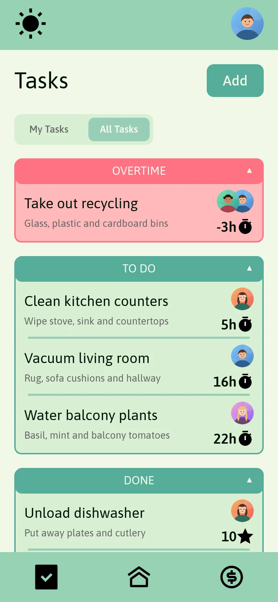
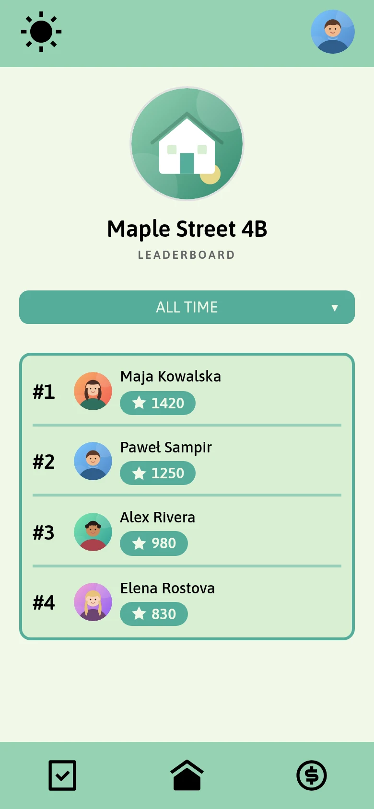
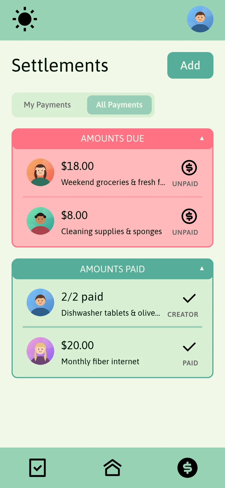
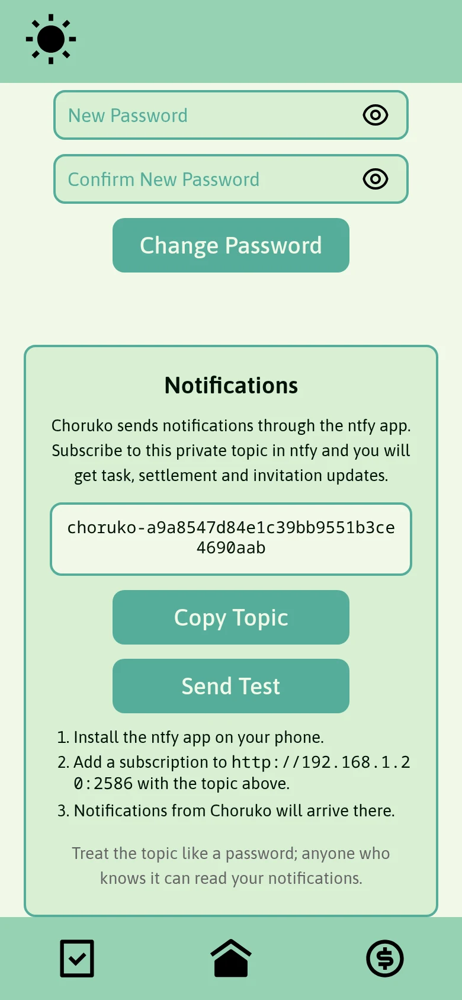
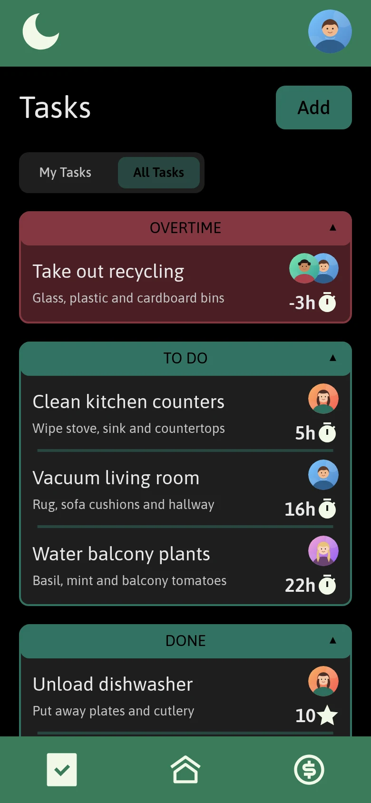
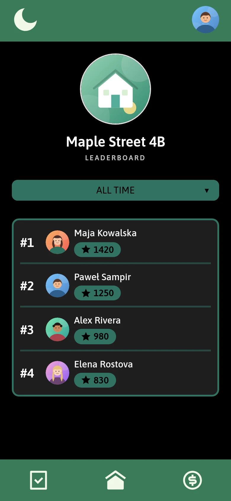
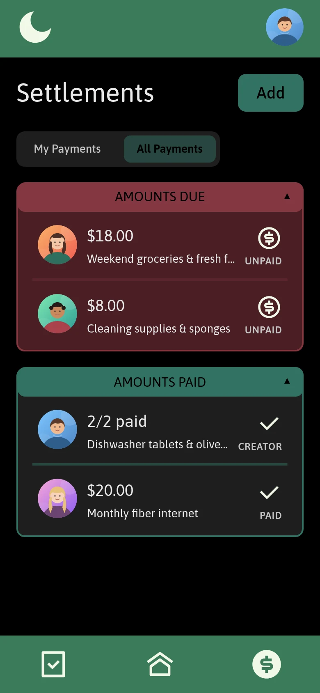
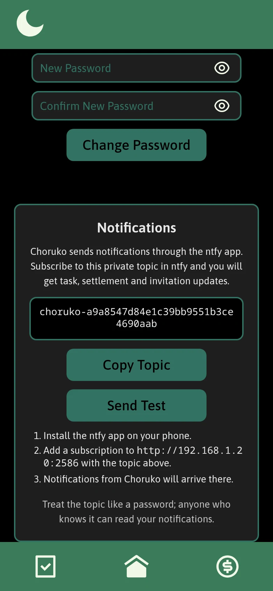

<p align="left">
  
</p>

# Choruko

<p>
  <a href="https://psampir.github.io/choruko/">
    
  </a>
</p>

**Choruko** is a self-hosted household management app for shared chores, points and
settlements. One household, several people, one place to agree on who does what and
who owes whom.

> Current release: **v1.1.1**. Notifications are delivered through the ntfy app, so
> a plain-HTTP instance on a trusted network is enough. Add a reverse proxy with a
> TLS certificate when the instance is reachable from other machines. See the
> [installation guide](docs/guides/install.md).

## What it does

- **Households**: create a household, invite people by email, transfer admin rights.
- **Chores ("tasks")**: name, description, deadline, assignees, participant limit,
  creation and completion. Overdue and upcoming tasks are highlighted.
- **Activities**: reusable chore types with a point value (for example *Wash the
  dishes* - 10 points). Five defaults are created with a new household.
- **Leaderboard**: monthly, yearly and all-time points per participant.
- **Settlements**: shared expenses with per-person settle/unsettle tracking.
- **Notifications**: new, edited and completed tasks, deadlines, invitations and
  settlements, delivered through ntfy (self-hosted or ntfy.sh).
- **Roles**: household admin, participant, and a locked-down "no household" role
  for new accounts.
- **Mobile-first UI**: light and dark themes, add-to-home-screen web clip on iOS
  and a native Android app from GitHub Releases.
- **Optional email**: SMTP password reset, or a command-line password reset in the
  `manager` container when email is disabled.

## Screenshots

Real screens captured from a four-person household, in both themes. The top row is
light mode, the bottom row is dark mode.

| Theme | Tasks | Leaderboard | Settlements | Account &amp; ntfy |
|:---:|:---:|:---:|:---:|:---:|
| Light |  |  |  |  |
| Dark |  |  |  |  |

Household administration is shown on the [project site](https://psampir.github.io/choruko/),
together with an interactive phone preview and the full light/dark gallery.

## Tech stack

| Layer | Stack |
|---|---|
| Frontend | React 19, TypeScript, Vite, SCSS, React Router |
| Backend | ASP.NET Core 10, EF Core 10, ASP.NET Core Identity (cookie auth), SkiaSharp for image processing |
| Database | PostgreSQL 17 |
| Packaging | Docker images for frontend, backend and a migration/admin manager |
| CI/CD | GitHub Actions (build, tests, GHCR images), Docker Compose |

## Quick start

Requirements: Docker with the Compose plugin.

```bash
mkdir choruko && cd choruko
curl -fsSLO https://raw.githubusercontent.com/psampir/choruko/refs/heads/main/docker/compose/prod/docker-compose.yml
curl -fsSL -o .env https://raw.githubusercontent.com/psampir/choruko/refs/heads/main/docker/compose/example.env

# edit .env: at minimum change DB_PASSWORD
docker compose up -d
```

Open `http://localhost:2467` (or the port set in `CHORUKO_PORT`), register the first
account and create a household.

The images are published on GHCR:

- `ghcr.io/psampir/choruko-frontend`
- `ghcr.io/psampir/choruko-backend`
- `ghcr.io/psampir/choruko-manager`

For upgrades, backups and the optional HTTPS setup, see the
[installation guide](docs/guides/install.md).

## Configuration

The full reference lives in [docs/guides/configuration.md](docs/guides/configuration.md).
The most important variables:

| Variable | Default | Purpose |
|---|---|---|
| `CHORUKO_VERSION` | `release` | image tag to deploy (`release`, `latest`, or a version) |
| `CHORUKO_PORT` | `2467` | host port for the web interface |
| `APP_DATA_LOCATION` | `./app_data` | profile and household pictures |
| `DB_DATA_LOCATION` | `./db_data` | PostgreSQL data directory |
| `DB_PASSWORD` | `postgres` | database password; change it |
| `DB_USERNAME` | `postgres` | database user |
| `DB_DATABASE_NAME` | `choruko` | database name |
| `ENABLE_EMAILS` | `false` | enable SMTP password-reset emails |
| `SMTP_*` | - | SMTP host, port, credentials and sender |
| `SERVER_URL` | - | public URL used in email links |
| `NOTIFIER` | `none` | `ntfy` enables notifications through ntfy |
| `NTFY_BASE_URL` | - | ntfy server base URL (self-hosted or `https://ntfy.sh`) |
| `NTFY_TOKEN` | - | optional ntfy access token |
| `PUBLIC_APP_URL` | - | public URL used in notification links |
| `TZ` | host timezone | container timezone |

## Development

- [Setting up the development environment](docs/guides/set-up-dev-env.md)
- [Building the Android app](docs/guides/android-app.md)
- Short version:

  ```bash
  docker compose -f docker/compose/dev/docker-compose.yml up -d
  cp backend/ChorukoAPI/Properties/launchSettings.example.json backend/ChorukoAPI/Properties/launchSettings.json
  dotnet tool restore --tool-manifest backend/ChorukoAPI/.config/dotnet-tools.json
  python3 backend/update-db.py
  ```

  Then run the backend (`dotnet run` in `backend/ChorukoAPI`, port 5180) and the
  frontend (`npm install && npm run dev` in `frontend/ChorukoWeb`, port 3000).

- Checks:

  ```bash
  dotnet test backend/ChorukoAPI.sln
  npm run lint --prefix frontend/ChorukoWeb
  npm run build --prefix frontend/ChorukoWeb
  ```

## Architecture

```
React 19 SPA (Vite)
        │  cookie auth, JSON
        ▼
ASP.NET Core 10 Web API  ──►  EF Core  ──►  PostgreSQL 17
        │
        └── background services (points reset, deadline reminders, cleanup)
```

The backend is a layered monolith: controllers call services, services own the
business rules and talk to EF Core, and responses are mapped to DTOs. The frontend
keeps per-domain React contexts that call small `fetch`-based services. See
[docs/architecture.md](docs/architecture.md) for the full tour.

| Path | Contents |
|---|---|
| `backend/ChorukoAPI` | API, services, EF Core models and migrations |
| `backend/*.Test` | xUnit tests for each service |
| `frontend/ChorukoWeb` | React SPA |
| `android` | Android shell (WebView + server address screen) |
| `docker` | Dockerfiles and Compose files |
| `docs` | installation, development, architecture, operations |

## Roadmap

- Run the app on a LAN without TLS.
- Native iOS shell, if a web clip turns out to be too limited.
- More tests around controllers and authentication.

## Contributing

Contributions are welcome. The branch flow is `feature → dev → main`; direct commits
to `main` are not accepted. Please read [CONTRIBUTING.md](CONTRIBUTING.md) first.

## Security

Please report vulnerabilities privately through GitHub Security Advisories, not in
public issues. See [SECURITY.md](SECURITY.md).

## License

Choruko is licensed under the **GNU Affero General Public License v3.0 or later**
(AGPL-3.0-or-later). If you modify the software and make it available to users over
a network, you must offer them the complete source code of your modifications. See
[LICENSE](LICENSE) and [NOTICE](NOTICE).
