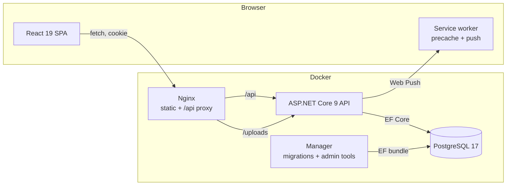

[← Back to README](../README.md)

# Architecture

Choruko is a small monolith with two deployable halves: an ASP.NET Core API and a
React single-page app. They talk JSON over HTTP and authenticate with a cookie.

## Backend

`backend/ChorukoAPI` is the whole API. `Program.cs` is the composition root: database
connection, Identity, cookie settings, CORS, DI registrations, hosted services and the
VAPID bootstrap. Start reading there.

| Directory | Responsibility |
|---|---|
| `Controllers/` | HTTP surface. Route, `[Authorize(Roles = …)]`, read the caller id, call a service, map the result. |
| `Contracts/` | Request DTOs, response DTOs, `ApiResponse<T>` and the internal `ServiceResponse<T>`. |
| `Services/` | Business rules. Interfaces in `Abstraction/`, implementations next to them, timed jobs in `Background/`. |
| `Data/` | `DataContext` (EF Core) and model configuration. |
| `Models/` | Entities: `User`, `Household`, `HouseholdTask`, `Activity`, `Settlement`, `Invitation`, `PushSubscription`. |
| `Mappers/` | `IMapper<TEntity, TResponse>` implementations. Entities never leave the API. |
| `Extensions/` | `ServiceResponseFactory`, `ResponseMapper`, notification helper, VAPID helpers. |
| `Migrations/` | EF Core migrations, applied by the `manager` container. |

### Request flow

A mutating request, for example completing a task:

1. `HouseholdTaskController.MarkTaskAsCompleted` checks the route and the caller.
2. `HouseholdTaskService` loads the task with its assignees and activity, adds the
   activity's points to each assignee, sets the status and saves.
3. The service builds a push payload and hands it to `IPushNotificationService`.
4. The service returns `ServiceResponse<OperationResultDto>`.
5. The controller maps it with `ToApiResponse()` to
   `{ result, message, isSuccessful }`.
6. The frontend context refreshes its data and the service worker shows the
   notification.

Expected failures are values, not exceptions: services return a failed
`ServiceResponse` with an HTTP status, and `ResponseMapper` turns it into a
`ValidationProblemDetails` body.

### Roles and household lifecycle

Roles are part of the product model:

- `None` — a fresh account, no household.
- `Participant` — member of a household.
- `HouseholdAdmin` — member and administrator.
- `Admin` — reserved for administrative tooling.

Registration creates a `None` user. Creating a household promotes the creator to
`HouseholdAdmin` and seeds five default activities. Accepting an invitation moves a
`None` user to `Participant`. Leaving or being removed returns the user to `None`.
Admin transfer swaps roles, updates `Household.AdminId` and rotates the new admin's
security stamp so an old cookie is invalidated.

### Background services

| Service | Interval | Work |
|---|---|---|
| `PointsResetService` | daily check | resets monthly counters on the 1st, yearly counters in January |
| `InvitationsDeleteService` | daily at midnight | deletes resolved invitations and pending ones older than 7 days |
| `TaskDeadlineNotificationService` | hourly | 24-hour reminders and overdue alerts |
| `DataCleanupService` | every 24 hours | deletes completed tasks and settlements older than 3 months |

## Frontend

`frontend/ChorukoWeb` is a Vite SPA. `src/App.tsx` mounts the providers and the
router; every route is lazy-loaded.

| Directory | Responsibility |
|---|---|
| `views/` | Route screens grouped by domain: auth, household, settlements, profile. |
| `contexts/` | Per-domain state. Each context calls a service and then refreshes. |
| `services/` | Small `fetch` clients with `credentials: "include"`. |
| `components/` | Shared UI; one folder per component with its SCSS. |
| `utils/` | Formatting, icons, images, error parsing. |
| `sw.ts` | Service worker: precache, push, notification click. |

The provider order is significant: `Auth → User → Household → Activity → Task →
Settlement`. Task and settlement contexts wait for `householdInfo.id`, which comes
from the household context, which depends on the authenticated user.

## Data model

- `Household` has an admin (`User`, 1:1) and participants (`User`, 1:n).
- `HouseholdTask` belongs to a household, optionally references an `Activity`, has a
  creator, a deadline, a status and a many-to-many set of assignees.
- `Activity` is a reusable chore type with a point value.
- `Settlement` belongs to a household, has an amount and two many-to-many sets:
  users who settled and users who still owe.
- `Invitation` links a sender, a receiver and a household, with a status and sent date.
- `PushSubscription` stores a browser endpoint and its keys.

All ids are GUID strings. Timestamps are stored as `timestamp without time zone`.
Entities use `virtual` navigations because EF Core lazy loading is enabled; services
still use `Include` where they need deterministic data.

## Conventions

- **Response envelope:** services return `ServiceResponse<T>`; controllers call
  `ToApiResponse()` or `ToCreatedApiResponse()`.
- **DTO mapping:** never return entities; add an `IMapper` and register it in
  `Program.cs`.
- **Registration is manual:** new services, mappers and hosted services must be added
  to `Program.cs`.
- **Mutations return `OperationResultDto`** with an operation name, timestamp and
  metadata.
- **Frontend types are hand-written** in `services/*.ts` and must be kept in sync with
  the backend contracts.

## Where to start

1. `backend/ChorukoAPI/Program.cs`.
2. `HouseholdTaskController` → `HouseholdTaskService` → `HouseholdTaskMapper`.
3. `frontend/ChorukoWeb/src/App.tsx` → `contexts/TaskContext.tsx` →
   `services/taskService.ts` → `views/Household/Tasks/Tasks.tsx`.
